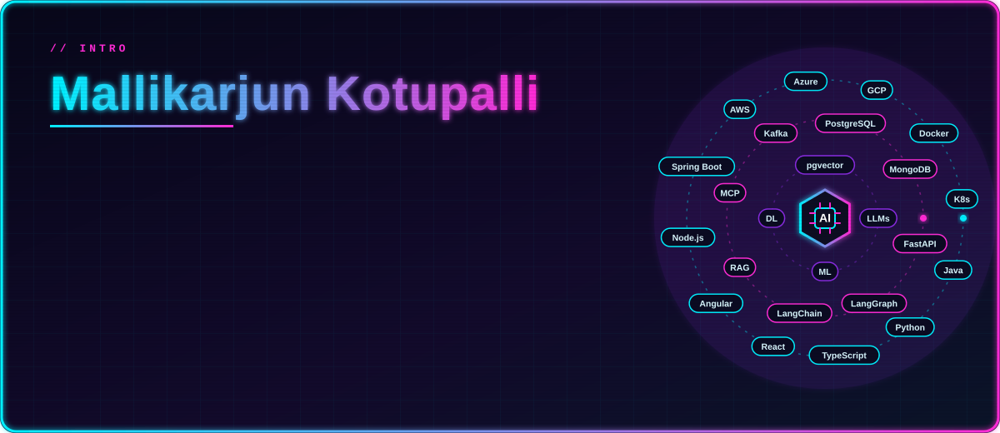
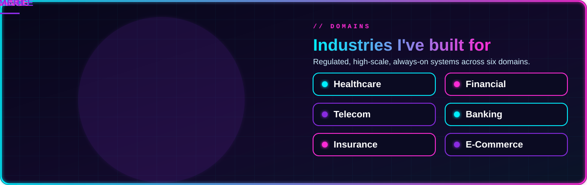
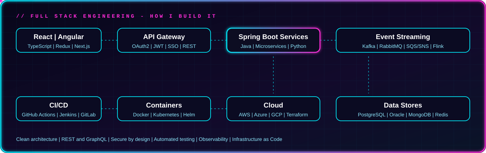
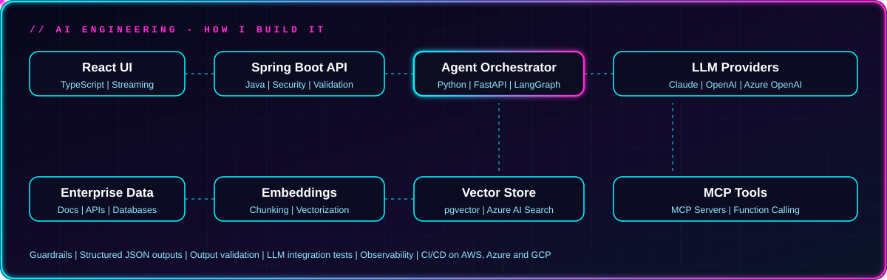

 

---

## `> hello_world`

Hi, I'm **Mallikarjun** - a full stack engineer who turns complex business problems into secure, scalable, production-grade software.

I work across the whole stack: **Java and Spring Boot** microservices, **React and TypeScript** interfaces, and **cloud-native delivery** on AWS, Azure and GCP. Increasingly, I build with **AI** - LLM-powered features, **RAG** pipelines, **agentic workflows** and **MCP** tool integrations, wrapped in the guardrails, validation and testing that production systems demand.

**Domains:** healthcare, financial services, telecommunications, banking, insurance and e-commerce.

**What you can expect from my work**

- Clean, well-tested code and clear API contracts
- Security-first design: OAuth2, JWT, SSO, encryption and auditability
- Event-driven, resilient services that scale and stay observable
- Automated pipelines from commit to production
- AI that is grounded, validated and measurable - not just a demo

## `> fullstack --engineering`

## `> ai --engineering`

| Capability | Tools and techniques |
|---|---|
| **LLMs and APIs** | Claude API (tool use), OpenAI APIs, Azure OpenAI, structured JSON-schema responses, prompt templates |
| **RAG** | Document ingestion, chunking, embeddings, vector search with pgvector and Azure AI Search, grounded answers |
| **Agents** | LangGraph stateful workflows, LangChain, OpenAI Agents SDK, tool and function calling, human-in-the-loop |
| **MCP** | Model Context Protocol servers and tools (Python and Spring Boot) giving agents governed access to enterprise APIs and data |
| **Python for AI** | FastAPI services, LangGraph orchestrators, RAG ingestion pipelines, evaluation and output validation alongside Java services |
| **ML and Deep Learning** | Machine learning and deep learning fundamentals, model serving behind REST APIs, embeddings and similarity search |
| **Data processing** | PySpark, Apache Flink and Kafka streaming pipelines |
| **AI in Java** | Spring Boot AI services, Spring AI, REST integration of LLMs into enterprise back ends |
| **Safety and quality** | Guardrails, output validation, prompt/response testing, LLM integration tests |
| **AI-assisted development** | Claude Code, OpenAI Codex, GitHub Copilot, Cursor |

## `> stack --all`

**AI and GenAI**

**Python, ML and Data**

**Languages**

**Backend and Architecture**

**Messaging and Streaming**

**Frontend**

**Cloud and DevOps**

**Data**

**Security, Testing and Observability**

## `> most_used_languages`

## `> connect`

Open to collaborating on full stack, cloud and AI engineering.

